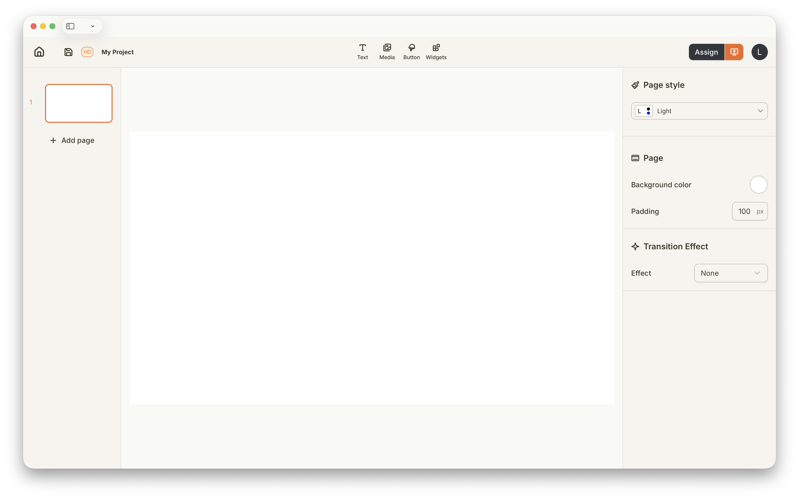
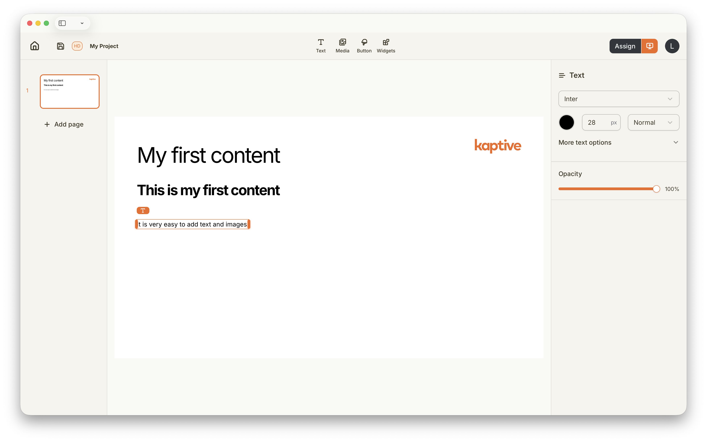

import { Steps } from '@astrojs/starlight/components';
import createProjectImg from '../../../../assets/getting-started/create-project/create-project.png';

## Qu'est-ce qu'un projet ?

Un projet dans Kaptive est un conteneur pour votre contenu d'affichage dynamique. Il vous permet de créer des mises en page, d'ajouter des médias et des éléments de contenu, et d'organiser le tout en un seul endroit. Un projet peut contenir plusieurs pages, chaque page remplissant l'intégralité de l'écran lors de la diffusion. Vous pouvez choisir de passer d'une page à l'autre automatiquement après une durée définie ou manuellement à l'aide d'éléments interactifs.

## Créer un nouveau projet

Vous pouvez créer un nouveau projet depuis la section projets du Kaptive Manager. Suivez ces étapes pour créer un nouveau projet :

<Steps>
    1. Dans la section projets, cliquez sur le bouton `Start new Project`.
    2. Entrez un nom et une résolution pour votre projet.

       

       La résolution doit correspondre à la résolution de l'écran sur lequel le contenu sera affiché.
    3. Cliquez sur `Create` pour finaliser la création de votre projet.
</Steps>

## Utiliser le Kaptive Editor

Le Kaptive Editor est une interface intuitive de type glisser-déposer qui vous permet de concevoir facilement votre contenu d'affichage dynamique. Vous pouvez ajouter divers éléments de contenu tels que des images, des vidéos, du texte et des widgets interactifs à vos pages de projet.

Le Kaptive Editor est divisé en 4 sections :

    1. La barre d'outils en haut donne accès aux paramètres du projet, aux contrôles de publication et aux outils pour ajouter des éléments de contenu.
    2. La barre latérale gauche contient la liste des pages de votre projet et vous permet de naviguer entre elles.
    3. La barre latérale droite affiche les propriétés et les paramètres de l'élément de contenu sélectionné, vous permettant de personnaliser son apparence et son comportement.
    4. La zone centrale du canevas est l'endroit où vous concevez vos pages de projet en ajoutant et en disposant les éléments de contenu.

## Créer votre premier contenu

Pour commencer, essayez d'ajouter quelques éléments de contenu à votre page de projet. Vous pouvez glisser-déposer des images, des vidéos et du texte depuis la barre d'outils sur le canevas. Expérimentez avec différentes mises en page et styles pour trouver ce qui convient le mieux à vos besoins d'affichage dynamique.

