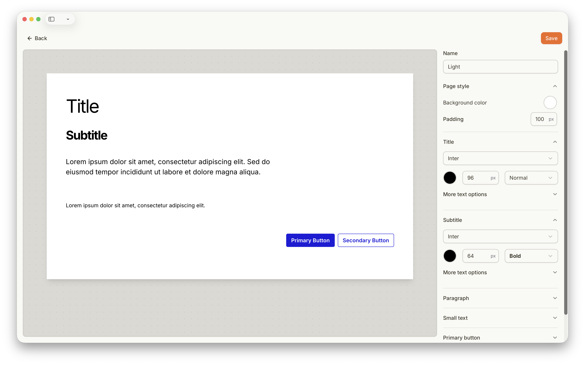

## À propos des styles de page

Chaque page possède un style de page qui définit son apparence par défaut, y compris la couleur d'arrière-plan, les polices et d'autres paramètres de style. Vous pouvez personnaliser le style de page pour qu'il corresponde à votre image de marque ou à vos préférences de design. Vous pouvez également créer différents Styles de page pour chaque page de votre projet.

Après avoir modifié un style de page, enregistrez-le pour l'appliquer à votre projet.
