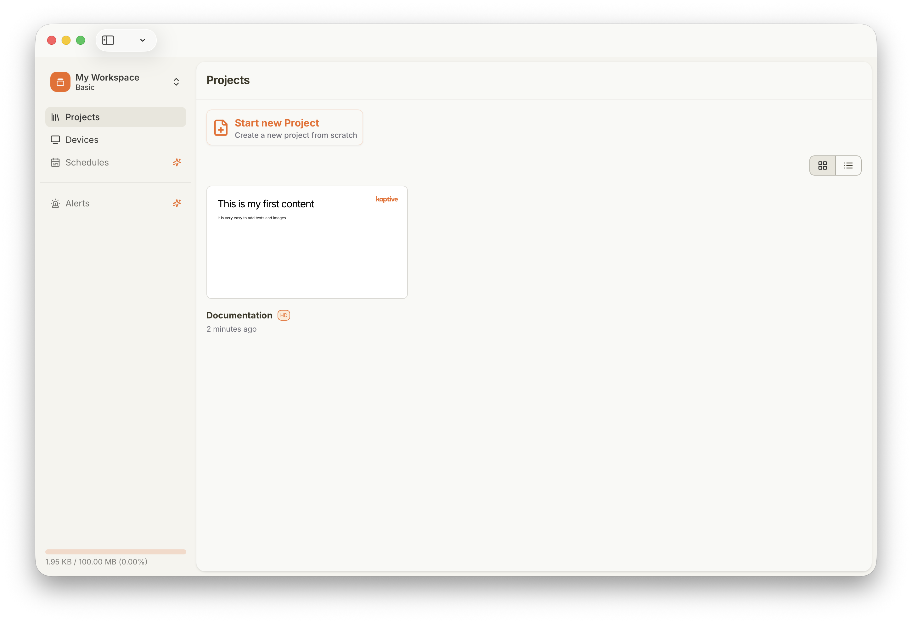
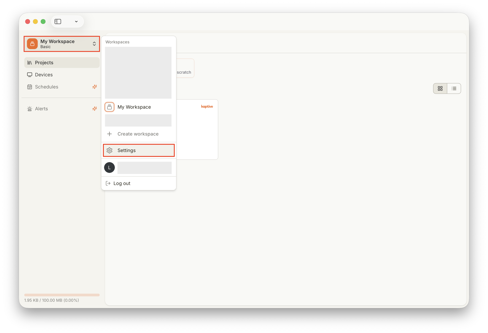
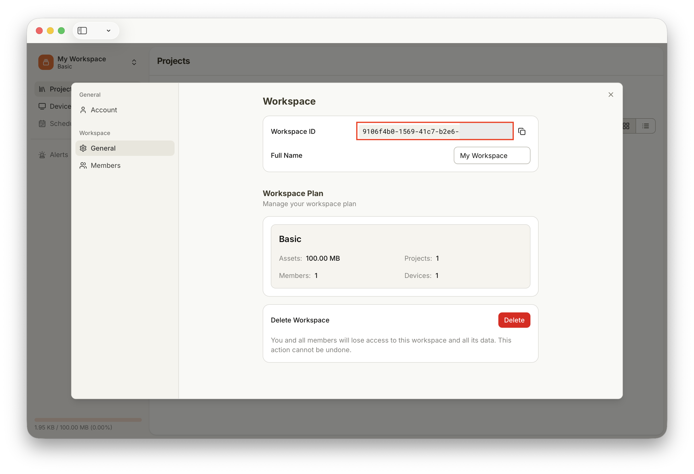

import { Steps } from '@astrojs/starlight/components';

Questa guida spiega come trovare l'identificatore univoco (ID) del tuo spazio di lavoro in Kaptive.

## Trova l'ID del tuo spazio di lavoro

<Steps>

1. **Apri lo spazio di lavoro**

    Accedi al Kaptive Manager e vai alla pagina progetti del tuo spazio di lavoro.

    

2. **Apri le Impostazioni**

    Clicca sul nome dello spazio di lavoro nell'angolo in alto a sinistra per aprire il menu a tendina, quindi seleziona `Settings`.

    

3. **Copia l'ID dello spazio di lavoro**

    Nelle Impostazioni, sotto Generale, troverai l'ID dello spazio di lavoro. Clicca sull'icona di copia accanto all'ID per copiarlo negli appunti e inviarcelo via email a [info@kaptive.ch](mailto:info@kaptive.ch).

    

</Steps>
